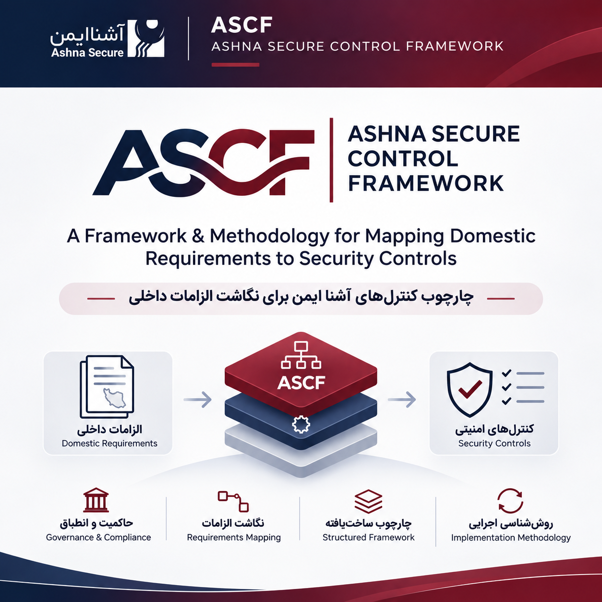

# ابزار یکپارچهٔ نگاشت SCF و ترجمهٔ فارسی

[English guide](README.md)

این بسته، ابزارهای نگاشت الزامات چند مرجع به SCF، استفاده از اهداف ارزیابی (AO) و ترجمهٔ تخصصی فارسی را در یک پروژه گردآوری می‌کند. هدف آن حفظ متن منبع، ردیابی تصمیم‌ها و کنترل خروجی قابل بازبینی است. این پروژه محصول رسمی SCF یا تأییدکنندهٔ خودکار انطباق نیست.

## قابلیت‌ها

- ورود Excel نسخهٔ مشخص SCF همراه با کنترل‌ها، AOها، مختصات و هش منبع؛ بدون تغییر خودکار نسخه.
- جست‌وجوی نامزدهای مرتبط در متن کنترل و AO با پردازش یونیکد و یک پل واژگانی محدود فارسی/انگلیسی؛ رتبهٔ جست‌وجو با قدرت رابطه متفاوت است.
- نگاشت هر تعهد مستقل، حفظ قیود بند اصلی، ثبت شاهد دقیق و گزینه‌های جایگزین، بررسی پوشش ترکیبی و شکاف باقیمانده.
- خروجی دقیقاً یک برگهٔ STRM Mapping و ده ستون؛ بازخوانی فایل ذخیره‌شده و تطبیق همهٔ مقادیر با تصمیم‌های ثبت‌شده.
- ترجمه و معادل‌یابی با تقدم واژه‌نامهٔ مصوب افتا؛ ورود تنها ۷۵۹ مدخل مجاز مرجع تکمیلی و حذف ۴۳ مدخل تعلیق‌شده از استفادهٔ اجرایی.

## منابع ترجمه

- **واژه‌نامهٔ مصوب افتا** (`AFTA_Approved_Glossary_Final.json`): مرجع نخست در صورت تطابق اصطلاح و معنای آن با بافت جمله؛ معادل مصوب عیناً حفظ می‌شود.
- **واژه‌نامهٔ تکمیلی امنیت سایبری**: `Cybersecurity_Glossary_FA.json` و Markdown همراه، با نام فایل تحویلی `Cybersecurity_Glossary_FA(1).md`. فقط `use_in_skill=true` مجاز است: **۷۵۹ مدخل قابل استفاده و ۴۳ مدخل تعلیق‌شده و خارج از استفاده**. Markdown برای تطبیق و ممیزی است و مسیر دور زدن فیلتر نیست. شناسه، منبع، صفحات و شواهد استخراج حفظ می‌شوند. تعریف‌های نقل‌شده مرجع تاریخی‌اند، نه توصیهٔ امنیتی روز.
- **پیشنهاد سازمانی یا مبتنی بر بافت با بازبینی صریح**: برای خلأ یا ابهام؛ کنار گذاشتن معنای افتا به دلیل مستند نیاز دارد. ابهام حل‌نشده با NEEDS_CONTEXT مشخص می‌شود.

متن اصلی انگلیسی SCF، شرح کنترل و اهداف ارزیابی (AO) مبنای وفاداری ترجمه‌اند. الزام، نفی، شرط، دامنه، زمان، کمیت و شناسه‌ها حفظ می‌شوند. جست‌وجوی واژه تأیید معنای جمله نیست و جایگزینی سادهٔ رشته‌ها انجام نمی‌شود. بسته مترجم خودکار متصل به API نیست. منابع واقعی محلی وارد می‌شوند و داخل مخزن عمومی نیستند؛ [ورود منابع](docs/SETUP.md).

## قواعد نگاشت و امتیازدهی

- **مرجع تصمیم:** اصل الزام و نسخهٔ ثابت SCF با هش و مشخصات منبع؛ ترجمه یا نگاشت قبلی جای شاهد اصلی را نمی‌گیرد. هر سند source_id مستقل دارد.
- **واحد نگاشت:** تعهد مستقل و قابل آزمون، همراه با مسئول اجرا، عمل، دامنه، زمان و قیود بند مادر. اعمالی که مستقل قبول یا رد می‌شوند جدا بررسی شوند.
- **انتخاب نامزد:** متن کنترل و AOهای متعلق به آن و گزینه‌های جایگزین بررسی می‌شوند. رتبهٔ BM25 و وزن کنترل SCF، قدرت رابطه نیستند.
- **جهت رابطه:** تعهد منبع → SCF. Equal / Equal To یعنی برابری دامنه؛ Subset Of یعنی تعهد زیرمجموعهٔ SCF؛ Superset Of یعنی تعهد شامل دامنهٔ SCF؛ Intersects With یعنی اشتراک الزام‌آور و تفاوت در هر دو طرف. شباهت موضوعی یا پشتیبانی اجرایی کافی نیست. نام رابطه و مبنای استدلال در پروفایل مشخص می‌شوند.
- **امتیاز نسخهٔ فعلی:** عدد صحیح ۱ تا ۱۰؛ ۵ تا ۱۰ اولویت دارند. اعتبارسنج فعلی ۱ تا ۴ را نیز به‌صورت fallback مستند، پس از جست‌وجو و نبود رابطهٔ قوی‌تر پذیرفته‌شده، مجاز می‌داند. این رفتار با سیاست سخت‌گیرانهٔ «فقط ۵ به بالا» یکسان نیست؛ در آن سیاست، موارد زیر ۵ باید بدون نگاشت ثبت شوند و fallback مجاز نیست. آستانه‌ها قواعد پروژه‌اند، نه ادعای الزام NIST.
- **شاهد و بازبینی:** نقل دقیق کنترل/AO، دلیل رابطه، تفاوت دامنه‌ها، گزینه‌های ردشده و شکاف باقیمانده ثبت شوند. برای برابری و زیرمجموعه بررسی شود آیا SCF می‌تواند برقرار باشد ولی بخشی از تعهد نقض شود. بازبینی انسانی و مدلی صریحاً تفکیک شوند.
- **نبود رابطه:** No Relationship با دلیل بازبینی‌شده و امتیاز خالی؛ برای افزایش پوشش رابطه ساخته نمی‌شود. پوشش ترکیبی و وضعیت همهٔ تعهدها ثبت شوند؛ نامزد حل‌نشده مانع خروجی است.
- **خروجی:** یک برگهٔ STRM Mapping با ده ستون ثابت؛ متن کنترل از کاتالوگ ثابت و بازخوانی فایل ذخیره‌شده برای تطبیق مقادیر. تأیید ساختاری معادل تأیید معنایی یا انطباق سازمان نیست.

[جزئیات روش کار](skills/scf-mapping-translation/references/workflow.md) · [قرارداد داده](skills/scf-mapping-translation/references/data-contract.md)

## شروع سریع

Python نسخهٔ ۳.۱۱ یا جدیدتر لازم است. فرمان‌ها را در پوشهٔ اصلی پروژه اجرا کنید:

~~~bash
python -m pip install -r requirements.txt
python skills/scf-mapping-translation/scripts/run.py --help
python skills/scf-mapping-translation/scripts/run.py validate --catalog examples/synthetic/catalog.json --inventory examples/synthetic/inventory.json --ledger examples/synthetic/ledger.json
python skills/scf-mapping-translation/scripts/run.py build-xlsx --catalog examples/synthetic/catalog.json --inventory examples/synthetic/inventory.json --ledger examples/synthetic/ledger.json --out local-data/demo.xlsx
python -m unittest discover -s tests -v
~~~

نمونه‌های عمومی کاملاً ساختگی‌اند و تأیید واقعی نگاشت یا بازبینی انسانی محسوب نمی‌شوند. برای کار واقعی، [راهنمای ورود منابع](docs/SETUP.md) و [قرارداد داده](skills/scf-mapping-translation/references/data-contract.md) را بخوانید. پوشهٔ skills/scf-mapping-translation را می‌توان با تمام فایل‌هایش در محل مهارت‌های عامل نصب کرد.

## قواعد اصلی

هر سند، شناسهٔ منبع مستقل دارد؛ شمارهٔ بندهای مشابه از دو مرجع با هم ادغام نمی‌شوند. هر تعهد باید جداگانه قابل آزمون باشد. قیود مسئول اجرا، دامنه، زمان و الزامات محلی محفوظ می‌مانند. نام و شرح کنترل از مرجع ثابت‌شدهٔ SCF می‌آیند. مقدمهٔ مشترک بند در خروجی فقط روی ردیف اول نمایش داده می‌شود و برای همهٔ تعهدها در ثبت داخلی باقی می‌ماند.

معادل مصوب افتا در صورت تطابق مفهوم مقدم است. تعریف‌های منبع تکمیلی فقط مرجع تاریخی‌اند و جای معادل مصوب را نمی‌گیرند. ترجمهٔ روان با بررسی جمله و بافت انجام می‌شود؛ ابزار جست‌وجو ترجمهٔ خودکار یا جایگزینی سادهٔ رشته‌ها انجام نمی‌دهد.

## انتشار و محدودیت‌ها

مطابق انتخاب مالک، حقوق انتشار کد محفوظ است و مجوز متن‌باز صادر نشده است. متن کامل کتاب‌ها، داده‌های واقعی SCF و اسناد خصوصی داخل ZIP عمومی قرار ندارند؛ مسیر ورود محلی آن‌ها آماده است. فایل‌های کاری در local-data نگهداری و از بستهٔ انتشار کنار گذاشته می‌شوند.

عبور از آزمون ساختاری به معنی تأیید معنایی رابطه، صحت استخراج PDF یا انطباق سازمان نیست. بازبینی‌ها باید واقعی و نوع بازبین، انسانی یا مدلی، صریح باشد. ترجمهٔ خودکار با API، OCR، نگاشت انتقالی و مهاجرت خودکار شناسه‌ها در این نسخه ادعا نمی‌شود.

[راهنمای استفاده](docs/USAGE.md) · [گزارش کنترل کیفیت](docs/QA.md) · [راهنمای انتشار در گیت‌هاب](docs/PUBLISHING.md)
