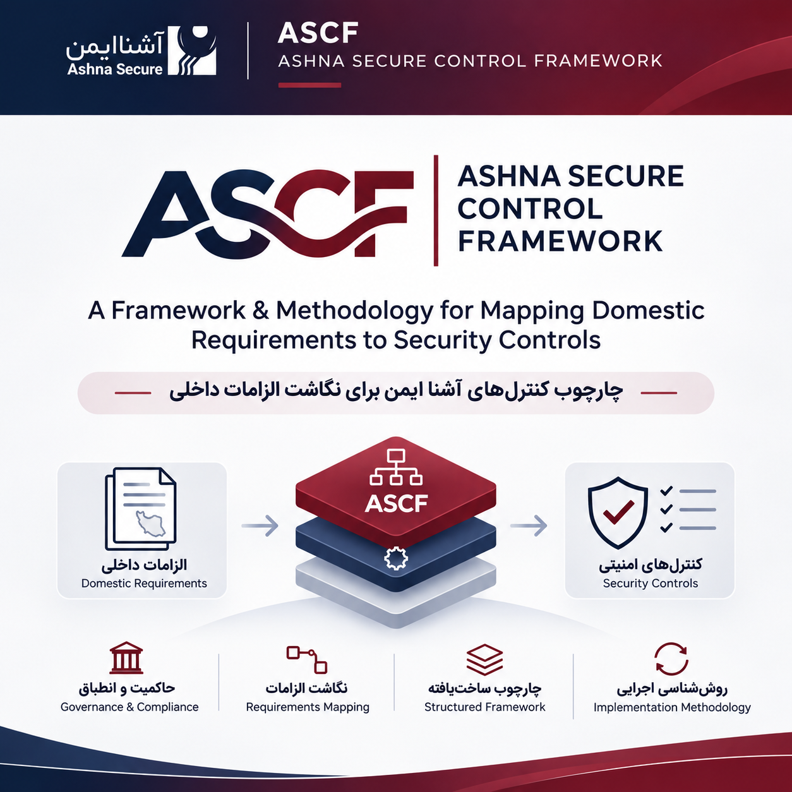

# SCF Mapping & Persian Translation Toolkit

[راهنمای فارسی](README.fa.md)

A local workflow toolkit for mapping independently testable regulatory requirements to a pinned Secure Controls Framework edition, with assessment-objective evidence and Persian terminology support.

This release brings the earlier mapping protocol, AO-aware candidate retrieval and Persian translation references into one tested codebase. It keeps source text and mapping decisions separate from translations. It is not an official SCF product or an automatic compliance determination.

## What it does

- Imports an explicitly selected local SCF workbook, including control descriptions, AOs, source coordinates and version/hash provenance.
- Finds candidates with Unicode BM25 over control and AO text, plus a small Persian-to-English retrieval bridge. Candidate ranks do not determine mapping strength.
- Handles several source documents without confusing identical clause numbers. Requires independently testable obligations, inherited context, exact evidence, reviewed alternatives and residual-gap accounting.
- Validates source/decision consistency and creates exactly one ten-column STRM Mapping worksheet. Reopens the saved XLSX and compares every value against canonical output.
- Supports Persian translation with AFTA-first terminology and a strictly filtered supplementary reference: 759 usable records; 43 held records excluded. It does not perform string-replacement translation.

## Quick start

Python 3.11 or newer is required. From an extracted repository:

~~~bash
python -m pip install -r requirements.txt
python skills/scf-mapping-translation/scripts/run.py --help
python skills/scf-mapping-translation/scripts/run.py shortlist --catalog examples/synthetic/catalog.json --query "ثبت رویدادهای امنیتی"
python skills/scf-mapping-translation/scripts/run.py validate --catalog examples/synthetic/catalog.json --inventory examples/synthetic/inventory.json --ledger examples/synthetic/ledger.json
python skills/scf-mapping-translation/scripts/run.py build-xlsx --catalog examples/synthetic/catalog.json --inventory examples/synthetic/inventory.json --ledger examples/synthetic/ledger.json --out local-data/demo.xlsx
python skills/scf-mapping-translation/scripts/run.py check-xlsx --catalog examples/synthetic/catalog.json --inventory examples/synthetic/inventory.json --ledger examples/synthetic/ledger.json --xlsx local-data/demo.xlsx
~~~

The complete public example is synthetic. A no-match row is included deliberately. Its example review records are fixtures, not real reviewer signoffs. Import authorized real sources with [setup instructions](docs/SETUP.md).

Optionally install the Python command:

~~~bash
python -m pip install .
scf-toolkit --help
~~~

For an agent skill, copy skills/scf-mapping-translation to the agent's supported skills location, preserving all scripts and references. Invoke it for translation, mapping or both. It does not require a cloud service or credentials.

## Documentation

| Guide | Contents |
| --- | --- |
| [Setup](docs/SETUP.md) | Dependencies, source imports and skill installation |
| [Usage](docs/USAGE.md) | Real workflow, decisions and translation QA |
| [Data contract](skills/scf-mapping-translation/references/data-contract.md) | Catalog, inventory, ledger and bilingual-unit fields |
| [Methodology](skills/scf-mapping-translation/references/workflow.md) | Source authority, relationship direction and review limits |
| [Migration](docs/MIGRATION.md) | Differences from mapping v7, Gold v3 and translation v2 |
| [QA](docs/QA.md) | Tests, real-data checks and known limitations |
| [Publishing](docs/PUBLISHING.md) | GitHub upload, description, topics and release checklist |
| [Third-party notices](THIRD_PARTY_NOTICES.md) | Source ownership, licensing and attribution |

## Checks

~~~bash
python -m unittest discover -s tests -v
python scripts/audit_release.py
~~~

GitHub Actions is configured for Windows and Ubuntu with Python 3.11 and 3.13. Workflow configuration is included; remote CI results exist only after the workflow actually runs in your repository.

## Data and rights

The public ZIP includes project code, documentation and synthetic fixtures. Real SCF catalogs, approved glossary exports, full book text, private regulatory documents, mappings and translated datasets are local inputs, excluded from the archive. Importing them is a separate documented step. Keep publisher attribution and obtain permission before distributing translated or otherwise adapted third-party content.

Per the owner's selection, project code is **all rights reserved** and has no open-source license grant. See [LICENSE](LICENSE). This restriction does not replace third-party licenses or publisher terms.

## Practical limits

The software verifies structures, exact quotations against supplied data, numeric rules, source fingerprints and saved workbook values. It cannot prove that a PDF was transcribed correctly, that an AO semantically covers a legal duty, that an asserted review happened, or that an organization complies. Keep those reviews explicit. Automatic LLM translation, OCR, semantic mapping, inverse/transitive mapping and automatic legacy-ID migration are not included.
